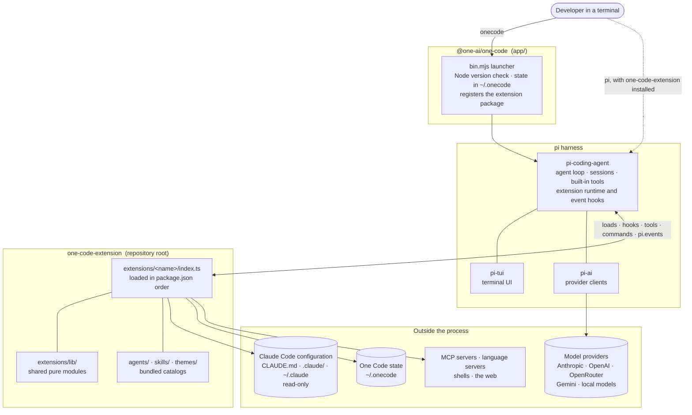
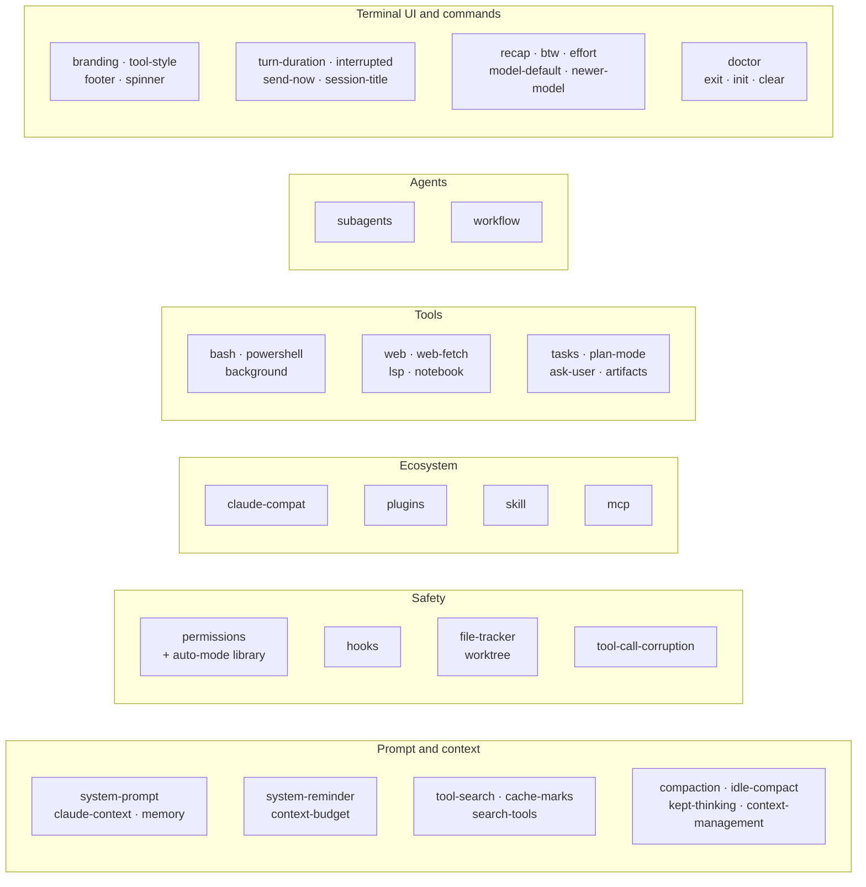
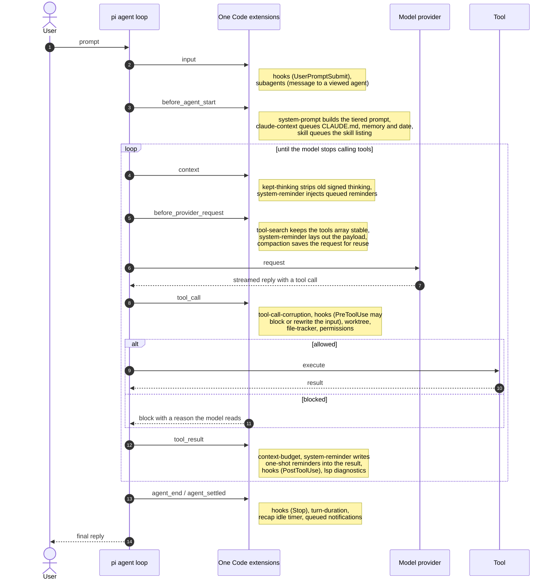
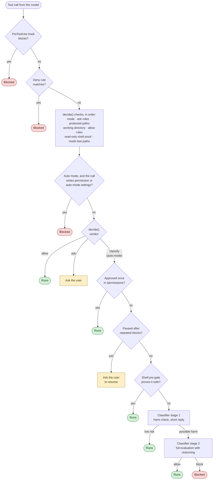
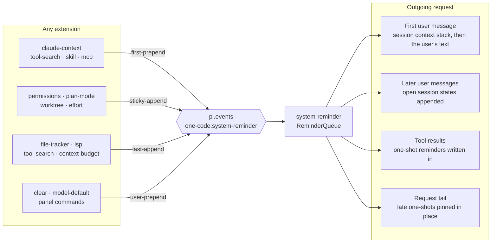
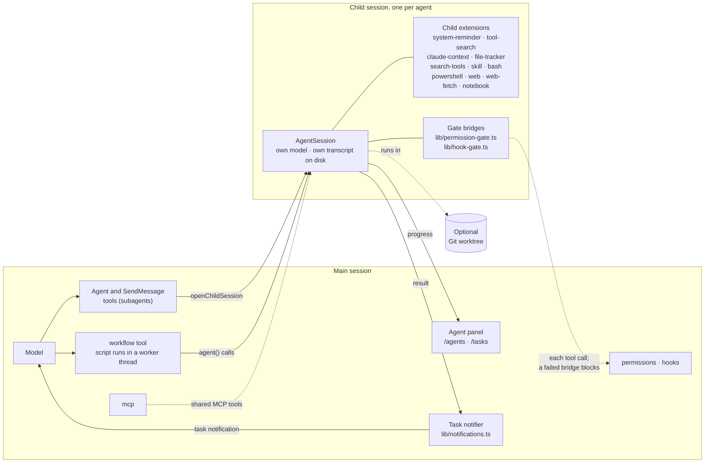
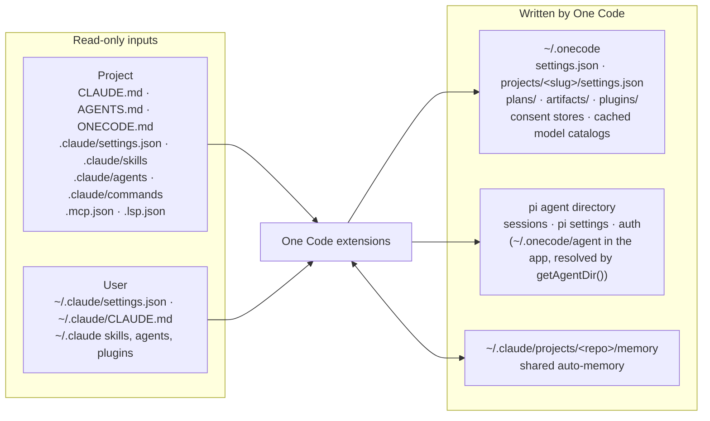

# Architecture

[← Developer docs](README.md)

One Code is a set of [pi](https://github.com/earendil-works/pi) extensions.
pi supplies the agent loop, sessions, the terminal UI and the provider
clients. One Code adds the prompts, tools, permission system, steering and
agent coordination on top, using only pi's public extension API. Nothing in
this repository forks or patches pi.

This page shows how the pieces fit together. Each diagram has a short
explanation and names the files to open next.

- [The big picture](#the-big-picture)
- [The extensions, by role](#the-extensions-by-role)
- [One turn through the hooks](#one-turn-through-the-hooks)
- [How a tool call is decided](#how-a-tool-call-is-decided)
- [Steering the model: the reminder queue](#steering-the-model-the-reminder-queue)
- [Subagents and workflows](#subagents-and-workflows)
- [Configuration and state on disk](#configuration-and-state-on-disk)

## The big picture

Two npm packages ship from this repository. `one-code-extension` (the
repository root) is the pi package: the extensions, the bundled agents,
skills and themes. `@one-ai/one-code` (`app/`) is the `onecode` command. It
bundles an exact-pinned pi, keeps its state in `~/.onecode` and registers the
extension package, so users get One Code without installing pi themselves.

Start with `package.json` (the `pi.extensions` list) and `app/bin.mjs`.

## The extensions, by role

Each folder under `extensions/` is one pi extension with a thin `index.ts`
that wires pi events to pure logic modules beside it. Shared logic lives in
`extensions/lib/`. `extensions/auto-mode/` is the one folder that is not an
extension: it is the auto-mode classifier library that `permissions` calls.

| Role | What the group does |
|---|---|
| Prompt and context | Builds the system prompt per model tier, loads project instructions and memory into the first message, steers the model through `<system-reminder>` blocks, defers rarely used tools behind `tool_search`, and compacts long sessions. |
| Safety | Decides whether each tool call runs (rules, modes, the auto-mode classifier), runs user hooks, guards against stale edits, confines work to a Git worktree, and stops calls from damaged provider streams. |
| Tools | The tools the model calls, beyond pi's built-in `read`, `edit` and `write`. |
| Agents | Background subagents with two-way messaging, and JavaScript workflow scripts that fan work out across many agents. |
| Ecosystem | Discovers Claude Code skills, commands, agents and plugins, and connects MCP servers. |
| Terminal UI and commands | Everything the user sees around the conversation, plus small slash commands. |

The architecture rules that keep these extensions working together are in
[Extension rules](extension-rules.md).

## One turn through the hooks

pi runs an agent loop and fires events at fixed points. One Code does almost
all of its work inside those event handlers. The sequence below follows one
user prompt that leads to one tool call. The names on the arrows are pi
events; the notes name the extensions that handle them.

Handlers for the same event run in the order the extensions appear in
`package.json`. That order is load-bearing; see
[Extension rules](extension-rules.md#load-order).

## How a tool call is decided

Every tool call passes the `tool_call` handler in
`extensions/permissions/index.ts`. The pure decision is `decide()` in
`extensions/permissions/matcher.ts`. In auto mode, calls the rules do not
settle go to the classifier in `extensions/auto-mode/`.

A few properties hold throughout:

- Deny rules win over everything, including `bypassPermissions` mode.
- An explicit ask rule always prompts, even in auto mode.
- The shell pre-gate can only conclude "safe". It never denies, so it can
  never be the reason a call is blocked. The rules for extending it are in
  [Extension rules](extension-rules.md#safety-and-permissions).
- Any classifier failure (no model, no credentials, a timeout, an unreadable
  reply) blocks. A gate that cannot reach its classifier has approved
  nothing.

## Steering the model: the reminder queue

Extensions never inject text into the conversation directly. They emit on
the `one-code:system-reminder` channel, and the `system-reminder` extension
places each block in the outgoing request. The placement depends on the kind
of fact, and every placement keeps already-sent messages byte-identical, so
the provider's prompt cache keeps hitting.

| Placement | For | Where it lands |
|---|---|---|
| `first-prepend` | Session context that never changes: instructions, memory, deferred tool names, the skill and agent catalogs | Front of the first user message, frozen after the first request |
| `sticky-append` | Session state that switches on and off: auto mode, plan mode, a worktree session | Every user message after the state switched on |
| `last-append` | One-shot news about what just happened: a file changed on disk, new diagnostics | Written into the next stored tool result, or pinned to the request's tail |
| `user-prepend` | Breadcrumbs from slash commands the user ran | Before the user's text on the next prompt |

The contract and the full rules are in the header of
`extensions/lib/reminders.ts`.

## Subagents and workflows

Subagents and workflow agents run in the same process as the main session.
Each one is a separate pi `AgentSession` opened through
`openChildSession` in `extensions/lib/agent-loader.ts`, with a curated set of
extensions (`extensions/lib/child-extensions.ts`). Safety and hooks reach the
child through bridges published by the parent, and completions come back to
the main session as notifications.

A few properties worth knowing before you change this area:

- A fork inherits the parent's conversation. Its request is built from the
  parent's last saved request plus the fork's own tail, so it reads the
  parent's prompt cache instead of paying for the whole conversation again.
- A child never loads `lsp` or `mcp`. MCP tools are shared in from the
  parent, and a child's language servers would outlive it.
- In one-shot runs (`-p`, `--mode json`) a background agent blocks until it
  finishes, because the process exits when the turn settles.

## Configuration and state on disk

One Code reads Claude Code's configuration and never writes it, with one
exception: per-repository memory, which both tools share. Everything One
Code writes goes to its own state directory.

The path helpers are `extensions/lib/paths.ts` (Claude Code locations),
`extensions/lib/one-code-settings.ts` (One Code's own settings) and pi's
`getAgentDir()` (pi state). The rules for using them are in
[Extension rules](extension-rules.md#paths-state-and-shells), and the
[configuration guide](../guide/configuration.md#what-is-stored-under-onecode)
lists what `~/.onecode` holds.
